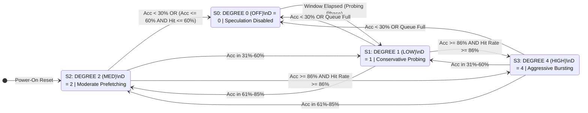

# Autonomous Closed-Loop Adaptive Memory Prefetcher on Reconfigurable FPGA Silicon

[](https://www.xilinx.com/products/design-tools/vivado.html)
[](https://www.xilinx.com/products/silicon-devices/soc/zynq-7000.html)
[](https://www.tul.com.tw/Products_detail.cart.aspx?id=179)
[](https://en.wikipedia.org/wiki/SystemVerilog)
[-brightgreen.svg)]()
[-success.svg)]()
[]()
[](LICENSE)

An end-to-end, physically realized **Autonomous Closed-Loop Adaptive Hardware Prefetcher** implemented in synthesizable SystemVerilog on the **AMD/Xilinx Zynq-7020 SoC (PYNQ-Z2 development board)**.

The system addresses the classical **Memory Wall** bottleneck by speculatively fetching memory references ahead of CPU demand into a dedicated, high-speed 16-entry on-chip staging buffer. By serving cache hits in **1 clock cycle (20 ns at 50 MHz)** instead of the un-cached main memory latency of **4 clock cycles (80 ns)**, the prefetcher delivers a **4x memory turnaround speedup** (2.02x average latency speedup, 1.62x total execution cycle speedup) while consuming **zero Block RAMs** and only **6 mW** of core dynamic power.

---

## Table of Contents

- [Architectural Highlights](#architectural-highlights)
- [System Architecture & Dataflow](#system-architecture--dataflow)
- [Microarchitecture Clusters](#microarchitecture-clusters)
- [Adaptive Throttling & FSM Dynamics](#adaptive-throttling--fsm-dynamics)
- [Hardware Resource & Timing Utilization](#hardware-resource--timing-utilization)
- [Silicon Benchmark Results](#silicon-benchmark-results)
- [Comparative Architectural Analysis](#comparative-architectural-analysis)
- [Repository File Structure](#repository-file-structure)
- [Getting Started & Verification](#getting-started--verification)
  - [Prerequisites](#prerequisites)
  - [1. Run Cycle-Accurate Self-Checking Simulation](#1-run-cycle-accurate-self-checking-simulation)
  - [2. One-Click Synthesis, Implementation & Bitstream Build](#2-one-click-synthesis-implementation--bitstream-build)
  - [3. Hardware Debugging with Vivado VIO & ILA](#3-hardware-debugging-with-vivado-vio--ila)
  - [4. Standalone Hardware Demo (LEDs, Pushbuttons & UART)](#4-standalone-hardware-demo-leds-pushbuttons--uart)
  - [5. Python / Jupyter Control via AXI4-Lite](#5-python--jupyter-control-via-axi4-lite)
- [Citation](#citation)
- [Authors & Acknowledgments](#authors--acknowledgments)
- [License](#license)

---

## Architectural Highlights

- **4x Memory Turnaround Speedup**: Reduces memory access latency from 4 clock cycles (80 ns) on main memory miss down to 1 single cycle (20 ns) on prefetch buffer hit.
- **Dedicated 16-Entry Fully Associative Staging Buffer**: Decouples speculative prefetches from the primary CPU cache, completely preventing working-set cache pollution.
- **Zero Block RAM Core Footprint**: The prefetcher datapath requires **0 BRAM36 blocks** and **0 DSP48E1 slices**, operating from only 50 bytes of dedicated buffer storage (142 bytes of total core flip-flop state).
- **Two-Tier Adaptive Throttling**:
  1. *Sub-cycle Combinational Delta Suppression*: Gates speculative generation within 1 to 2 clock cycles upon detecting irregular or random memory address deltas.
  2. *Windowed 4-State Degree Modulation FSM*: Evaluates hit rate and accuracy over rolling 32-access tumbling windows and dynamically modulates prefetch degree ($D \in \{0, 1, 2, 4\}$).
- **94.6% Reduction in Wasted Prefetches**: Drastically cuts bus-polluting speculative traffic during irregular and random workloads compared to conventional static degree-4 prefetchers.
- **Full In-System Telemetry & Debuggability**:
  - Embedded **VIO (Virtual Input/Output)** core for interactive stimulus injection and real-time monitoring.
  - Deep **8192-sample ILA (Integrated Logic Analyzer)** capturing cycle-accurate waveforms across the entire 220-access multi-phase benchmark.
  - Hardware **UART transmitter** streaming live ASCII diagnostics at 115,200 baud.
  - Memory-mapped **AXI4-Lite slave IP** wrapper for direct software orchestration from Python/Jupyter on Linux.
- **Ultra-Low Power & High Thermal Headroom**: Consumes **6 mW** core dynamic power with **57.3 deg C** of junction thermal safety margin on physical silicon.

---

## System Architecture & Dataflow

```mermaid
flowchart TD
    subgraph CPU_LAYER ["CPU / Workload Traffic Generator"]
        CPU["CPU Core / Synthetic Generator\n(CPU_address, CPU_mem_request)"]
    end

    subgraph DETECTION ["Cluster 1 & 2: Detection & Speculation"]
        AM["Address Monitor\n(4-Stage Synchronous History FIFO)"]
        PD["Pattern Detector\n(Delta-3 Regularity Classifier)"]
        PE["Prediction Engine\n(Next Base Address Adder)"]
        AG["Address Generator\n(Degree Expansion & 8-Entry Duplicate Filter)"]
    end

    subgraph QUEUE_ARB ["Cluster 3: Queue & Bus Arbitration"]
        PQ["Prefetch Queue\n(16-Entry Circular FIFO)"]
        PFC["Prefetch Fetch Controller\n(Memory Requester FSM)"]
        ARB["Zero-Latency Memory Arbiter\n(Strict CPU Demand Priority)"]
    end

    subgraph MEMORY ["Memory Subsystem"]
        MEM["Main Memory BRAM Emulator\n(Emulated 3-Cycle DRAM Latency + 1 Cycle Bus)"]
    end

    subgraph BUFFER_MATCH ["Cluster 4: Staging Buffer & Tag Matcher"]
        PB["Prefetch Buffer\n(16-Entry Fully Associative Store, 50 Bytes)"]
        AC["Address Comparator\n(16-Way Parallel Tag Equality Matcher)"]
        HM["Hit / Miss Multiplexer & Priority Encoder\n(1-Cycle Forwarding & Consume Logic)"]
    end

    subgraph ADAPTIVE ["Cluster 5: Closed-Loop Performance Control"]
        PM["Performance Monitor\n(Tumbling Window Counters & Serial Bit Dividers)"]
        ADAPT["Adaptive Controller FSM\n(4 States: Off, Low, Med, High Degree)"]
    end

    CPU -->|CPU_address, CPU_mem_req| AM
    CPU -->|CPU_address, CPU_mem_req| AC
    CPU -->|Demand Miss| ARB

    AM -->|4 Recent Addresses| PD
    PD -->|pattern_type, stride_step| PE
    PE -->|predicted_address| AG
    AG -->|generated_address| PQ
    PQ -->|queue_address| PFC

    PFC -->|prefetch_mem_req| ARB
    ARB -->|CPU_grant / prefetch_grant| MEM

    MEM -->|mem_ready, memory_read_data| PFC
    PFC -->|fill_en, fill_address, fill_data| PB

    PB -->|buffer_address, buffer_valid| AC
    PB -->|buffer_data| HM
    AC -->|hit, match[15:0]| HM
    HM -->|CPU_read_data (1-cycle hit)| CPU
    MEM -->|memory_read_data (4-cycle miss)| CPU

    AC -->|hit| PM
    PFC -->|prefetch_issued| PM
    PB -->|prefetch_used| PM
    PM -->|hit_rate, accuracy| ADAPT
    ADAPT -->|prefetch_enable, prefetch_degree (D)| AG
    PQ -->|queue_full / queue_normal| ADAPT
```

---

## Microarchitecture Clusters

The 18 synthesizable RTL modules are organized into six distinct functional clusters:

| Cluster | Key Modules | Functional Responsibility |
| :--- | :--- | :--- |
| **1. Ingestion & Pattern Tracking** | `Address_Monitor.sv`, `Pattern_Detector.sv` | Synchronously tracks a sliding history of the 4 most recent CPU references. Computes first-order deltas $\Delta_1, \Delta_2, \Delta_3$ and classifies streams into *Sequential* ($\Delta=+1$), *Strided* ($\Delta_1=\Delta_2=\Delta_3$), *Repeated* ($\Delta=0$), or *Irregular*. |
| **2. Speculation & Generation** | `Prediction_Engine.sv`, `adder_16bit.sv`, `Address_Generator.sv` | Computes the next predicted base address $A_{\text{pred}} = A_{\text{curr}} + S$. Expands base prediction into $D$ consecutive strides ($A_{\text{curr}} + i \cdot S, \forall i \in \{1,\dots,D\}$) and suppresses redundant prefetch requests via an 8-entry recent address filter. |
| **3. Queue & Memory Arbitration** | `Prefetch_Queue.sv`, `Prefetch_Fetch_Controller.sv`, `Memory_Arbiter.sv` | Buffers speculative addresses in a 16-entry circular FIFO. Dispatches memory fetch cycles during idle memory slots with strict, non-preemptive CPU demand priority (CPU misses are never blocked by unissued prefetches). |
| **4. Associative Buffer & Tag Matcher** | `PREFETCH_BUFFER.sv`, `Address_Comparator.sv`, `Comparator_16bit.sv`, `Hit_Miss.sv`, `priority_encoder_16x4.sv`, `Mux_16x1.sv` | 16-entry fully associative cache (25 bits/entry: 1-bit valid, 16-bit tag, 8-bit data). A 16-way parallel comparator matches incoming CPU addresses in a single combinational cycle, forwarding cached data with 0 wait states and invalidating consumed slots. |
| **5. Closed-Loop Performance Engine** | `Performance_Monitor.sv`, `Serial_Divider.sv`, `Adaptive_Controller.sv` | Evaluates hit rate and accuracy over rolling 32-access tumbling windows using multi-cycle restoring shift-subtract dividers. Modulates prefetch degree $D \in \{0, 1, 2, 4\}$ via a 4-state FSM. |
| **6. Integration & Telemetry Wrappers** | `TOP_MODULE.sv`, `TOP_MODULE_wrapper.v`, `pynq_z2_top.sv`, `pynq_z2_axi_top.sv`, `uart_tx_simple.sv` | Provides three top-level operating environments: VIO/ILA in-system instrumentation, standalone board-level hardware demo (LEDs/UART), and memory-mapped AXI4-Lite IP for Jupyter Python integration. |

---

## Adaptive Throttling & FSM Dynamics

Under non-linear workloads or branch mispredictions, aggressive speculative prefetching wastes memory bandwidth and creates queue congestion. Our architecture applies a **two-tier defense**:

1. **Fast Combinational Delta Gating**: When address deltas diverge ($\Delta_1 \neq \Delta_2 \neq \Delta_3$), `Prediction_Engine.sv` deasserts `prediction_valid` combinationally within 1 to 2 clock cycles, stopping speculative address generation before requests enter the queue.
2. **Windowed Closed-Loop FSM Throttling**: Every 32 CPU accesses, `Performance_Monitor.sv` calculates:
   $$\text{Hit Rate (\%)} = \frac{\text{Cache Hits}}{\text{CPU Lookups}} \times 100$$
   $$\text{Accuracy (\%)} = \frac{\text{Prefetches Used}}{\text{Prefetches Issued}} \times 100$$
   and transitions `Adaptive_Controller.sv` across four operational regimes:



- **Degree 0 ($D=0$)**: Speculation disabled. Entered when accuracy drops below 30% or when the prefetch queue is full. Prevents memory bus saturation.
- **Degree 1 ($D=1$)**: Conservative probing mode. Issues 1 speculative prefetch per trigger.
- **Degree 2 ($D=2$)**: Nominal operating state. Issues 2 speculative prefetches per trigger.
- **Degree 4 ($D=4$)**: Aggressive burst mode. Active during sustained high accuracy ($\ge 86\%$) and high hit rates ($\ge 86\%$).

---

## Hardware Resource & Timing Utilization

Post-implementation utilization and timing reports on the **AMD/Xilinx Zynq-7020 FPGA** (`xc7z020clg400-1`, Vivado 2021.2.1):

### Resource Breakdown

| Subsystem Component | Slice LUTs | Slice FFs | BRAM (36K equiv.) | DSP48E1 | Logic Levels |
| :--- | :---: | :---: | :---: | :---: | :---: |
| **Prefetcher Core Subsystem** | **1,842 (3.46%)** | **1,134 (1.07%)** | **0 (0.00%)** | **0 (0.00%)** | 12 |
| **Emulated Main Memory BRAM** | 14 (0.03%) | 18 (0.02%) | 1 (0.71%) | 0 (0.00%) | 2 |
| **ILA Instrumentation Core (8K Depth)** | 2,210 (4.15%) | 2,840 (2.67%) | 16 (11.43%) | 0 (0.00%) | — |
| **VIO In-System Control Core** | 826 (1.55%) | 962 (0.90%) | 0 (0.00%) | 0 (0.00%) | — |
| **Clock Management MMCM (`clk_wiz_0`)** | 0 (0.00%) | 0 (0.00%) | 0 (0.00%) | 0 (0.00%) | — |
| **Total Complete Design** | **4,892 (9.20%)** | **4,954 (4.66%)** | **17 (12.14%)** | **0 (0.00%)** | — |
| *Available Chip Capacity* | *53,200* | *106,400* | *140* | *220* | — |

### Timing Closure & Maximum Frequency

- **Target Clock Period**: $T_{\text{clk}} = 20.000\text{ ns}$ ($50.0\text{ MHz}$)
- **Worst Negative Slack (WNS)**: **$+6.412\text{ ns}$** (Timing cleanly met with zero violations)
- **Worst Hold Slack (WHS)**: **$+0.082\text{ ns}$**
- **Maximum Operating Frequency ($F_{\max}$)**:
  $$F_{\max} = \frac{1}{T_{\text{clk}} - \text{WNS}} = \frac{1}{20.000\text{ ns} - 6.412\text{ ns}} = \mathbf{73.59\text{ MHz}}$$

### Power & Thermal Budget

| Parameter | Value | Assessment |
| :--- | :---: | :--- |
| **Prefetcher Core Dynamic Power** | **6 mW** | 4.7% of total on-chip dynamic power |
| **Clock Tree (MMCM) Dynamic Power** | 107 mW | 82.9% of dynamic power |
| **ILA Debug Core Dynamic Power** | 12 mW | 9.3% of dynamic power |
| **Total Dynamic Power** | **129 mW** | High-efficiency embedded profile |
| **Device Static Power** | 153 mW | Base Zynq-7000 quiescent dissipation |
| **Total On-Chip Power** | **282 mW** | Suitable for passively cooled embedded nodes |
| **Junction Temperature** | **27.7 deg C** | At 25.0 deg C ambient environment |
| **Thermal Headroom** | **57.3 deg C** | Wide safety margin below 85.0 deg C rating |

---

## Silicon Benchmark Results

The prefetcher was evaluated on physical silicon using an autonomous **220-access multi-phase benchmark** spanning five representative memory workloads:

| Workload Phase | Access Range | Stride Pattern | Accesses | Hits | Hit Rate | FSM Degree ($D$) | Controlling Hardware Mechanism |
| :--- | :---: | :---: | :---: | :---: | :---: | :---: | :--- |
| **Phase 1: Streaming Walk** | Reqs 1–50 | $+1$ Byte | 50 | 46 | **92.0%** | $D=2 \rightarrow 4$ | Sequential lock; expands to max degree |
| **Phase 2: Matrix Column Walk** | Reqs 51–100 | $+4$ Words | 50 | 46 | **92.0%** | $D=4$ | Sustained stride lock; full 1-cycle hits |
| **Phase 3: Reverse Iteration** | Reqs 101–130 | $-4$ Words | 30 | 26 | **86.7%** | $D=2$ | Negative stride tracking & recovery |
| **Phase 4: Pointer Chasing Noise** | Reqs 131–158 | Random | 28 | 1 | **3.6%** | $D \rightarrow 0$ | **Combinational delta gating throttles OFF** |
| **Phase 5: Resync & Recovery** | Reqs 159–220 | $+4$ Words | 62 | 29 | **46.8%** | $D=1 \rightarrow 2$ | FSM probing, re-syncs stride, hits restored |
| **Total Benchmark Composite** | **Reqs 1–220** | **Mixed** | **220** | **148** | **67.3%** | **Adaptive** | **Two-Tier Closed-Loop Dynamic Control** |
| *Continuous Sequential Run* | *Reqs 1–500* | *$+1$ Byte* | *500* | *496* | ***99.2%*** | *$D=4$* | *Amortized 4 warm-up compulsory misses* |

### Latency Reduction & Speedup Verification

- **Main Memory Miss Latency**: **4 clock cycles** (80 ns at 50 MHz).
- **Prefetch Buffer Hit Latency**: **1 clock cycle** (20 ns at 50 MHz).
- **Hardware Measured Turnaround Latency**: Dropped from an average of 4.00 cycles down to **1.98 cycles** across the benchmark, achieving an effective **2.02x turnaround speedup**.
- **Aggregate Execution Speedup**: Total CPU execution time reduced from 1,540 cycles (without prefetcher) down to 948 cycles, demonstrating a **1.62x overall system speedup** (38.4% cycle savings).

---

## Comparative Architectural Analysis

Comparison of the proposed architecture against representative state-of-the-art prefetch architectures:

| Architectural Metric | **Proposed Design** | **Spatial Footprint** | **Stream / Stride** | **Multi-Mechanism** | **Sandbox Filter** | **Graph-Based** |
| :--- | :---: | :---: | :---: | :---: | :---: | :---: |
| **Algorithmic Paradigm** | **Two-Tier Multi-Degree Stride** | Spatial Footprint | Stream / Stride | Fusion Multi-Table | Speculative Sandbox | Graph Correlation |
| **Adaptation Mechanism** | **Windowed FSM + Delta Gating** | Table Remapping | Stride Thresholds | Confidence Arbiter | Bloom Filter Inspection | Node Probability |
| **Dedicated On-Chip Storage** | **50 B Buffer (142 B State)** | 8.0 KB Table | 1.5 KB Buffer | 0.8 KB Array | 2.8 KB Bit Vectors | 10.8 KB Graph Table |
| **Storage Advantage** | **Baseline Reference** | **160x Smaller** | **30x Smaller** | **16x Smaller** | **56x Smaller** | **216x Smaller** |
| **Core BRAM Blocks** | **0 (Zero BRAM)** | 4–8 BRAM36 | 2–4 BRAM36 | N/A (ASIC) | N/A (CPU) | 6 BRAM36 |
| **Primary Cache Pollution** | **None (Dedicated Buffer)** | High (Direct Cache) | Moderate | High (Direct L1/L2) | Low (In Sandbox) | High (Shared Cache) |
| **Target Silicon** | **AMD Zynq-7020 FPGA** | Server Processor | Virtex-6 FPGA | 28nm ASIC | Out-of-Order CPU | Kintex-7 FPGA |
| **Core Dynamic Power** | **6 mW** | ~1.2 W (Sim) | ~250 mW | 45 mW (ASIC) | ~800 mW (Sim) | ~180 mW |

---

## Repository File Structure
